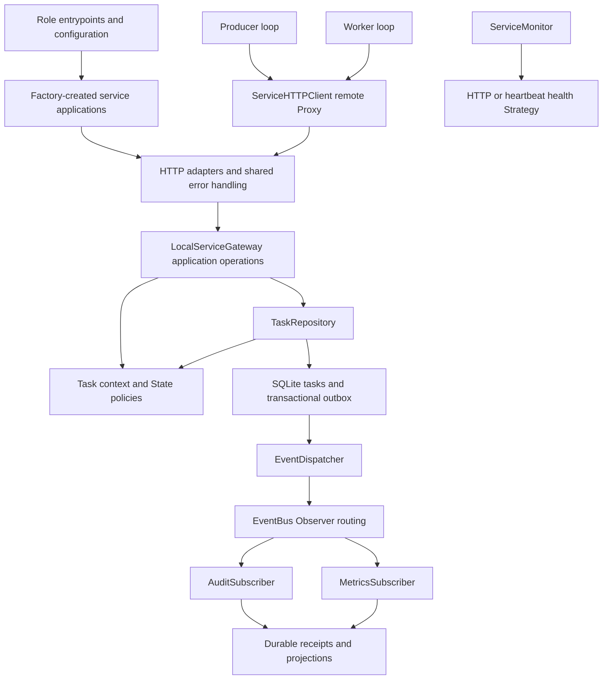
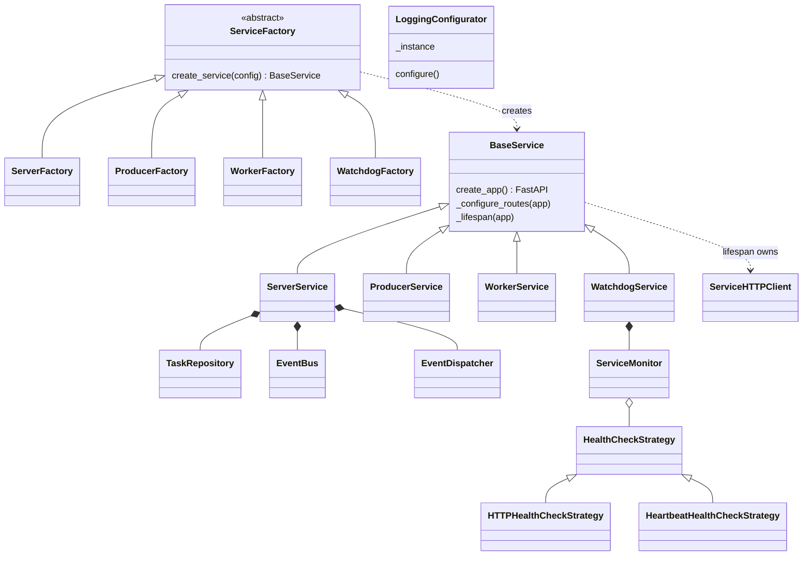
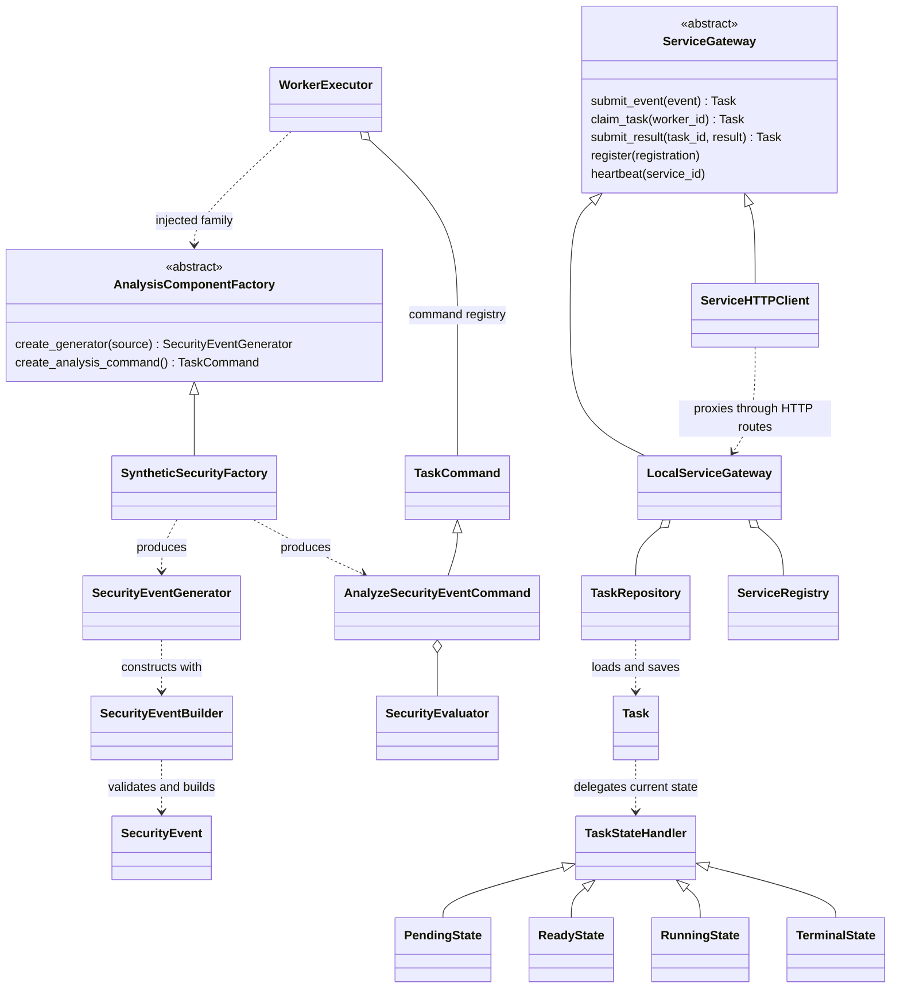
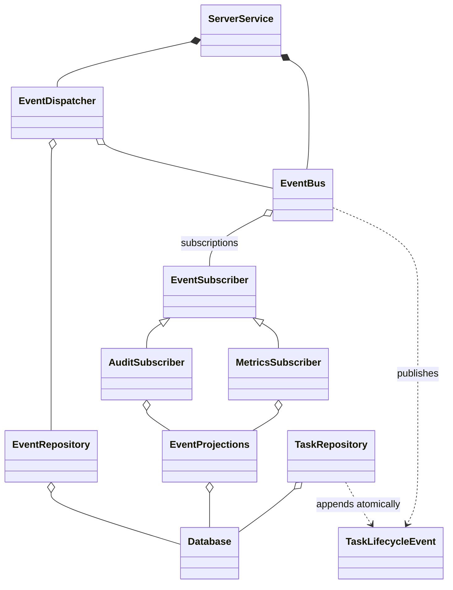

# Architecture and rubric map

## Layers and ownership

SQL and connections remain in `storage`; transition policies do not know about
HTTP or SQLite. Routes translate transport errors; local gateway operations run
blocking storage through the cancellation-safe storage helper. Pipelines depend
on `ServiceGateway`, not HTTP internals. FastAPI lifespans own clients and background
tasks and cancel/await tasks before closing resources. Repository instances are
injected/application-owned; no database, queue or registry is globally shared.

## Class diagram

The diagrams split the class model into readable families; arrows represent
inheritance, implementation, composition or runtime use in the repository.

## Requested PASS/GOOD criteria: implementation and evidence

This maps **every named criterion in the request**, not an unseen marking sheet.
The original repository already implements much of the durable execution system;
this work completes missing patterns, validates edge cases and documents boundaries.

| Criterion | Concrete implementation / runtime use | Evidence |
| --- | --- | --- |
| Source control | Existing phased Git history; scoped uncommitted changes; ignores for generated/private files; reproducible CI | `git log`, `git diff --check`, `.gitignore`, `.github/workflows/ci.yml`; no commit/push performed |
| Object orientation | Role inheritance, encapsulated repositories, composed monitor/observers, explicit ABC contracts and constructor injection | `test_factory`, `test_patterns`, `test_strategies`, `test_safety` |
| Class diagram | Diagrams above match actual class names and relationships | Compare to the referenced modules; diagrams are documentation, not generated runtime metadata |
| Logging | Singleton logging bootstrap at `serve`; service/health/recovery logs; JSON lifecycle audit with durable receipts | `test_patterns`, `test_event_projections`, `test_recovery`, `test_watchdog`, `test_safety` |
| Complete unit coverage | Coverage threshold is 100% with branches, covering all `sentinel` modules including CLI entrypoints; abstract declarations alone excluded | `coverage run -m unittest discover -s tests` then `coverage report`; 120 tests, 1,459 executable statements and 244 branches verified on Python 3.14.7 with coverage 7.17.3 |
| Repository persistence | SQLite WAL, short transactions, FIFO claims, duplicate conflict detection, exact JSON validation, atomic outbox | `test_repository`, `test_task_events`, `test_event_repository`, `test_safety`, recovery/events smoke |
| Singleton | `common/logging.py`: lock-protected `LoggingConfigurator.__new__`; used by entrypoint, preserves existing host handlers | Concurrent identity and repeated-config tests in `test_patterns`; no global domain/resource state |
| Builder | `producer/builder.py`: staged source/type/payload, optional replay UUID/time, isolated validated `build()` | `SecurityEventGenerator.generate()` uses it on every production event; incomplete/invalid/reused/copy-isolated builds in `test_patterns` |
| Factory Method | `core/factory.py`: role creators each override `create_service()` for one service product | All four CLI `main()` functions call the appropriate creator through `serve`; `test_factory`, `test_patterns` |
| Template Method | `BaseService.create_app()` fixes lifespan/state/errors/health sequence then calls `_configure_routes()` | Server/watchdog override hooks, not the template; hook-order and common-route tests in `test_patterns`; lifespan regression tests |
| Abstract Factory | `AnalysisComponentFactory` creates the related generator and analysis command; `SyntheticSecurityFactory` supplies the shipped matching vocabulary/policy | Producer loop and `WorkerExecutor` consume the factory; all event types evaluated, alternate family injected into both loops in `test_patterns` |
| Proxy | `ServiceGateway` is the Subject; `LocalServiceGateway` is local implementation; `ServiceHTTPClient` is the remote Proxy owning HTTP serialization/timeouts/connections | Production pipelines use Subject contract; `test_safety.ProxyIntegrationTests` runs identical operations against local and HTTP implementations; transport/error/cleanup tests |
| Command | `TaskCommand` / `AnalyzeSecurityEventCommand`, dispatched by worker-local `WorkerExecutor` registry | Delegated evaluator, unknown commands, worker-thread execution and result retry tests in `test_tasks` / `test_pipeline` |
| Observer | `EventSubscriber` / `EventBus`, metrics and audit subscribers, durable dispatcher/receipts | Wildcard/typed routing, duplicate registration, subscriber isolation, replay/crash boundaries, unsubscribe race; event tests and smoke |
| State | `Task` delegates to pending/ready/running/terminal State objects; policies own readiness, lease acquisition, finish/retry and expiry recovery | Full allowed/forbidden state matrix, immutable contexts, boundary expiry, token/owner checks, retry exhaustion; `test_patterns`, `test_repository`, `test_recovery` |
| Layered integration | HTTP adapters → gateway → domain/repository; storage owns SQL; infrastructure errors translated at boundary | Local/HTTP substitutability, ASGI APIs, temporary SQLite integration, all prior phase tests |
| Runtime behavior | Six independent processes, both producers/workers, health policies, advancing heartbeats, proper cancellation/cleanup | Pipeline, recovery, lifecycle events, watchdog and communication smoke scripts |
| Regression | Prior 100 tests retained (one read-response assertion updated for intentional token redaction); added boundary/pattern tests | All 120 tests plus process smokes; CI enforces lint, dependency consistency and coverage |
| Structured errors | Stable `error.code/message/next_action`, compatible string `detail`, sanitized validation fields; 409/422 vs 503 vs safe 500 | `server/errors.py`, `common/errors.py`, `test_safety` |
| README / comments / docstrings | Short entry guide, separate operational reference, this rubric map; module/class docstrings explain contracts, comments explain non-obvious invariants | `README.md`, `docs/operations.md`; no credentials/raw payloads in examples |

Factory Method selects **one service role product**; Abstract Factory selects the
**related producer/analysis products**, so these are not the same renamed switch.
Only one real security-analysis family is shipped; injection tests demonstrate
substitution without inventing a second unused production domain. State handlers
are stateless reusable policies, not global mutable task contexts. Logging is
process-local infrastructure: multiple services in one test process do not share
queues, clients, repositories or registry contents through the Singleton.

## Delivery and error semantics

1. Submit validates and deduplicates the security event. Repository saves READY
   plus CREATED/READY outbox entries in the same SQLite transaction.
2. Worker claims the oldest READY task, receiving a fresh token and deadline.
   Claim increments attempts. State objects reject skipped/terminal operations.
3. Command executes outside central; result retries retain the same lease/result
   and do not re-execute. Only an active token/owner may finish.
4. Failure or expired lease requeues while attempts remain, otherwise fails
   permanently. Recovery and result changes append matching outbox events atomically.
5. Dispatcher delivers ordered batches per subscriber. Failure/unregistration
   never acknowledges missing work; audit/metrics use durable receipts on replay.

Errors preserve legacy string `detail`, not FastAPI's former validation-detail
list: validation fields are now in top-level `fields`. Clients inspecting error
bodies should migrate to `error.code` and `fields`. Task read clients must not
expect lease capabilities, and unbounded task-list consumers must page. No database
schema migration is needed. Old data violating new validation constraints needs
operator repair; corruption is explicit, never silently discarded.

## Non-goals and honesty

Proxy here means a **remote application-operation Proxy**, not an authorization
proxy. There are no customer/admin applications, passwords, role-based login,
OTP or full booklet authentication flows. Registration validates identities and
addresses but does not establish trust. The system still needs deployment-level
TLS, access control, request-size/rate limits, backup policy and operational
supervision before use outside a trusted development environment. Passing coverage
or this engineering checklist does not prove completion of unspecified professor
requirements, freedom from vulnerabilities, or a particular grade.
