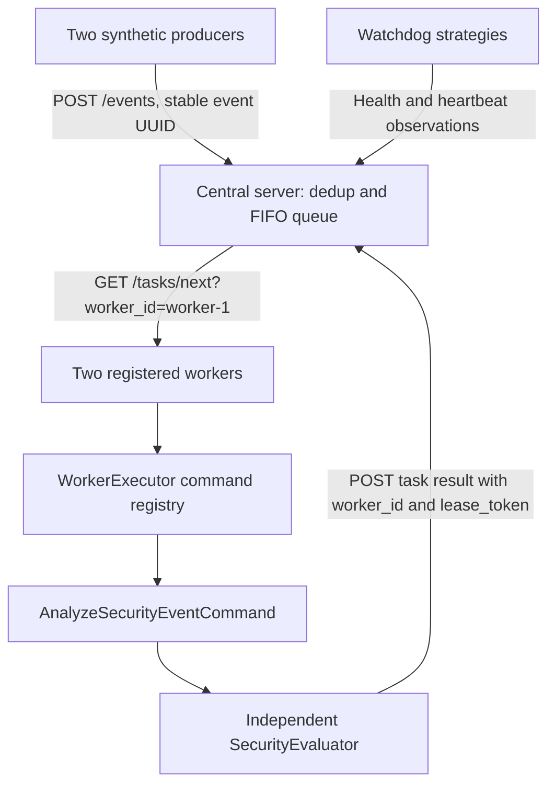
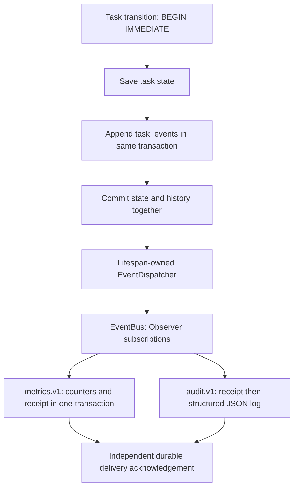

# Sentinel operations guide

See the [README](../README.md) for setup, current verification, and scope;
see [architecture](architecture.md) for the class diagram and pattern/rubric map.
The phase sections below retain the operational history, with current API changes
noted here and in the task API section.

Sentinel is a Python 3.14 university project for distributed security event
processing. Producers generate synthetic events, the central server queues them,
workers evaluate them, and an independent watchdog monitors service health.
Services run as separate processes or Docker containers.

## Setup and tests

Use `python3.14` explicitly, not an unverified `python3` default. All commands use
one environment, `.venv`. Deactivate and delete any older environment before
recreating it; do not overlay environments from different Python versions.

```bash
python3.14 -m venv .venv
source .venv/bin/activate
python -m pip install -r requirements-dev.txt -c requirements.lock
.venv/bin/python -m unittest discover -s tests -v
.venv/bin/python tests/smoke_watchdog.py
.venv/bin/python tests/smoke_communication.py
```

Runtime requirements are in `requirements.txt`, tested constraints in
`requirements.lock`, and coverage/lint tools in `requirements-dev.txt`.
Unit tests need no network. The Phase 2/3 smoke scripts launch bounded independent subprocesses,
require permission to listen on localhost and free ports 8000–8002 and (for the
watchdog smoke) 8005. Allow TCP TIME_WAIT to expire before running the unchanged
Phase 2 smoke immediately after another smoke using the same ports. Every child
is stopped and awaited in `finally`, with bounded waits and a kill fallback.

## Read-only demo page

With the services running, open **http://localhost:8000/**. The dependency-free
page shows watchdog health observations, queued/running/completed/failed task
counts, and the latest 10 tasks with producer, worker, classification, risk score,
and result or failure details. Sections refresh independently, 3 seconds after
all requests finish; unavailable data is explicitly labelled, not shown as healthy.
The page makes only read-only requests and never claims tasks.

The central server proxies watchdog status at `GET /demo/status`; no browser CORS
configuration is needed. `WATCHDOG_URL` defaults to `http://127.0.0.1:8005` for local
processes and is set to `http://watchdog:8000` for the main server in Compose.
Set it to your external watchdog's HTTP(S) base URL when needed. The proxy uses a
shared lifespan-owned client with an explicit `HTTP_TIMEOUT` request timeout and
total deadline; redirects are not followed. The page displays watchdog observation
times (not registration/heartbeat health claims), and shows unavailable if the
watchdog cannot be reached. Like the existing APIs, this demo has no authentication;
keep it on a trusted local network. The existing Dockerfile includes the HTML.

## Security-event pipeline (Phases 5–6)



The server **never executes commands**. Factory Method creates services; Command
encapsulates worker analysis; the existing Strategy pattern selects watchdog
health policy. Synchronous command execution uses `asyncio.to_thread`, so worker
health and heartbeats remain responsive. Each producer/worker lifespan shares one
async HTTP client between independent heartbeat and pipeline tasks; teardown cancels
and awaits both tasks before closing that client. Cancelling a thread await cannot
kill a synchronous command already running; current evaluation is short and bounded.

Synthetic events contain exactly `event_id` (UUID), `source` (the producer's
service ID), `event_type`, `timestamp` (aware and normalized to UTC), and a dictionary
`payload`. Event types describe activity, not classifications:

| Event type | Classification | Risk score | Triggered rule |
| --- | --- | --- | --- |
| `login_success` | `BENIGN` | 0 | `login_success` |
| `login_failed` | `SUSPICIOUS` | 40 | `login_failed` |
| `access_denied` | `HIGH_RISK` | 80 | `access_denied` |

`SecurityEventGenerator` in `sentinel/producer/generator.py` cycles all three types,
using fictional user `fictional-alex` and documentation-only IP `192.0.2.10`
(RFC 5737), not real user data. `SecurityEvaluator` lives independently in
`sentinel/security/evaluator.py`, with no HTTP dependencies. It returns exactly
`event_id`, `classification`, `risk_score`, `triggered_rule` (the matched event
type), and `processing_timestamp` (an ISO-formatted aware UTC evaluation time).
`TaskCommand` and `AnalyzeSecurityEventCommand` live in `sentinel/core/commands.py`;
the analysis command delegates to the evaluator. `WorkerExecutor` in
`sentinel/worker/executor.py` owns the small command registry. The server only
queues events and stores results; it does not classify events.

| Setting | Default | Meaning |
| --- | --- | --- |
| `EVENT_GENERATION_INTERVAL` | `2` | Seconds between submissions/retries; positive finite |
| `WORKER_POLL_INTERVAL` | `1` | Seconds between worker iterations/retries; positive finite |
| `PROCESSING_DELAY` | `0` | Optional nonnegative async demonstration delay before execution |

The first pipeline iteration waits one configured interval after registration.
Heartbeats keep running independently. Producers retain the exact pending event,
including ID and timestamp, until acknowledgement; an ambiguous HTTP timeout does
not create another event. Identical event resubmission returns the original task
in its current state; the same event UUID with different content returns **409**.
Each worker retains its computed success/failure result across transient HTTP
failures, without re-executing or claiming another task. Result 404/409 is logged
and released locally (e.g. server restart or lost terminal acknowledgement).
Unknown commands produce a failure result; central requeues failures while
attempts remain.

### Task API

Existing `/health`, `/register`, `/heartbeat`, `/services`, and watchdog `/status`
APIs retain their paths. Errors now share the structured envelope documented in
the README, registration hosts are validated, and central IDs are reserved.
Central task endpoints:

| Method/path | Response |
| --- | --- |
| `POST /events` | Validated event → deduplicated READY task (200) |
| `GET /tasks?limit=50&after_task_id=UUID` | Bounded forward pages in insertion order (limit 1–200); `latest=true` selects a recent initial window |
| `GET /tasks/next?worker_id=worker-1` | Atomically claim oldest READY task; 204 with no body if empty |
| `GET /tasks/{task_id}` | One task, or 404 |
| `POST /tasks/{task_id}/result` | Current lease holder's success → COMPLETED; failure → READY or FAILED |
| `GET /stats` | `total`, `pending`, `ready`, `running`, `completed`, `failed`, `queue_depth`, `attempts`, `retry_attempts`, `recovery_count`, `expired_active` |

Only the claim response exposes `lease_token`; ingestion, list, detail and result
responses omit it, including idempotent ingestion of an already RUNNING task.
Task listing defaults to the oldest 50; pass the last task ID as `after_task_id`
to traverse the entire history forward by insertion order. Use `latest=true` for
a recent initial window; the demo uses `limit=10&latest=true`. An unknown cursor
returns 404. A cursor takes precedence over `latest` and starts after that task
even when its state changes. The internal `snapshot()`
remains unbounded for offline tooling/tests; HTTP and demo reads use bounded SQL.

Event payloads and success results must be JSON-safe with finite numbers,
maximum depth 32 (root depth 0), 10,000 nodes, and 65,536 encoded bytes. Event
sources are bounded to 256 characters. Invalid input is 422 before storage;
UTC conversion overflow and oversized lifecycle sequence cursors are also 422.
Existing invalid/corrupt task records are **not silently removed or repaired**:
reads/claims report `503 storage_corruption` with backup/repair guidance. If an
expired corrupt task is encountered during startup recovery, startup fails with
the same domain exception in the logs; repair the database before restarting.
Back up existing databases before upgrading. Newly saved tasks are validated
both as Python models and from their exact JSON representation in the transaction.
These are payload bounds, not a general HTTP request-body/rate-limiting defense.

Claims and results require an existing registry identity with role WORKER.
Unknown identity/task returns 404; non-worker identity, wrong owner, invalid state,
wrong/expired/superseded lease token, conflicting duplicate event, or mismatched
result event ID returns 409, without modifying the task or counters. Invalid
request schemas return 422. An analysis success must include the task's event ID.
Every result requires the UUID `lease_token` returned by its claim (missing/invalid
token is 422). Upgrade central and all worker clients together: old clients that
omit the token can no longer submit results. Results use a discriminated `outcome`: either `status=success`
with a result dict,
or `status=failure` with a nonblank error, never both.

Example (stop automatic workers if you want to claim this task manually):

```bash
curl --fail --max-time 3 http://127.0.0.1:8000/register \
  -H 'Content-Type: application/json' \
  -d '{"service_id":"manual-worker","role":"worker","host":"127.0.0.1","port":9000}'
curl --fail --max-time 3 http://127.0.0.1:8000/events \
  -H 'Content-Type: application/json' \
  -d '{"event_id":"a0000000-0000-4000-8000-000000000001","source":"manual-producer","event_type":"login_failed","timestamp":"2026-11-05T12:00:00Z","payload":{"user":"fictional-alex","source_ip":"192.0.2.10"}}'
curl --fail --max-time 3 'http://127.0.0.1:8000/tasks/next?worker_id=manual-worker'
# Replace TASK_UUID and LEASE_UUID with the claim's task_id and lease_token.
# Submit before lease_expires_at. Use the claimed event's event_id.
curl --fail --max-time 3 http://127.0.0.1:8000/tasks/TASK_UUID/result \
  -H 'Content-Type: application/json' \
  -d '{"worker_id":"manual-worker","lease_token":"LEASE_UUID","outcome":{"status":"success","result":{"event_id":"a0000000-0000-4000-8000-000000000001","classification":"SUSPICIOUS","risk_score":40,"triggered_rule":"login_failed","processing_timestamp":"2026-11-05T12:00:01Z"}}}'
# Alternative failure body:
# {"worker_id":"manual-worker","lease_token":"LEASE_UUID","outcome":{"status":"failure","error":"analysis failed"}}
curl --fail --max-time 3 http://127.0.0.1:8000/stats
```

Lifecycle is `PENDING → READY → RUNNING → COMPLETED | FAILED`. Ingestion creates
READY immediately; PENDING is a domain construction state. Explicit transition
methods reject skipped/repeated/terminal transitions. Failures and expired leases
return RUNNING tasks to READY while attempts remain; otherwise they become FAILED.
Only the explicit recovery operation can reclaim an expired lease. SQLite
transactions protect deduplication, claims, result validation, and recovery.
Returned nested models are independent snapshots, and transition methods return new
tasks without mutating originals.

### Verification and intentional limits

```bash
.venv/bin/python -m unittest discover -s tests -v
.venv/bin/python tests/smoke_pipeline.py --timeout 35
# Optional independent port range:
.venv/bin/python tests/smoke_pipeline.py --base-port 18860 --timeout 35
```

The bounded stdlib smoke launches six independent processes, checks all six health
APIs, completed events from **both producers**, assignment/results from **both
workers**, advancing completions and four heartbeats, plus five healthy discovered
watchdog observations. It verifies the exact event and result fields, all three
classifications, risk scores, triggered rules, and aware UTC processing timestamps.
It always terminates and awaits its children, with a kill fallback. Default ports are 18760–18765. The existing Phase 2/3/4 smokes remain valid.

## Phase 6: durable tasks, leases, and bounded retries

`storage/database.py` initializes an idempotent SQLite schema and indexes, with WAL,
a 5-second busy timeout, and short-lived connections. `storage/task_repository.py`
is the single source of truth; `server/tasks.py` retains the `TaskQueue` import as
an alias, not a second queue. Direct callers supply a file path and call
`initialize()`; service/factory construction does no filesystem I/O. Server
lifespan initializes storage and recovers expired leases before becoming healthy.
Task routes run in FastAPI's thread pool; startup and periodic recovery use
`asyncio.to_thread`, so SQLite work does not block the event loop. Teardown cancels
and awaits recovery, including any in-flight transaction, before returning.

| Setting | Default | Meaning |
| --- | --- | --- |
| `DATABASE_PATH` | `data/sentinel.db` | SQLite file; parents created at startup; central only |
| `TASK_LEASE_SECONDS` | `30` | Finite positive seconds per claim; no renewal |
| `TASK_MAX_ATTEMPTS` | `3` | Strict positive integer, persisted per task at submission |
| `RECOVERY_INTERVAL_SECONDS` | `5` | Finite positive seconds between recovery scans |

Atomic `BEGIN IMMEDIATE` transactions serialize submission/deduplication, FIFO
claims, results, and recovery across connections/repository instances. FIFO uses
creation time with a stable insertion-sequence tie breaker. Canonical JSON compares
all event fields and distinguishes JSON field types (`true`, `1`, `1.0`, and `"1"`
are different). Resubmission after restart returns the original task ID, state,
and outcome. Tasks retain the complete event and current outcome, attempts/limit,
lease, UTC timestamps, last error, and cumulative recovery count in SQLite.

Each claim increments `attempts` and assigns a fresh UUID token and UTC expiry.
Results require RUNNING state, assigned worker, matching token, and an unexpired
lease at transaction time. Expiry is inclusive (`now >= lease_expires_at`).
Success becomes COMPLETED; execution failure is saved and requeued if attempts
remain, otherwise FAILED. Recovery clears ownership/token/expiry and requeues or
fails expired tasks using the same persisted limit. Repeated scans are idempotent.
Terminal tasks are immutable. Last failure outcome/error is retained during READY
and RUNNING retries; a successful result replaces the outcome and clears the error.
Lease-expiry recovery records `Task lease expired`. Completed tasks retain their
finishing worker identity for inspection, but no active token/expiry.

`/stats` returns current-state counts and `queue_depth=ready`, plus durable
`attempts=sum(attempts)`, `retry_attempts=sum(max(attempts-1, 0))`, and
`recovery_count=sum(recovery_count)`. `expired_active` counts RUNNING leases expired
at read time, before recovery. These are task-lifetime counters, not process-local
metrics; rejected submissions/results do not increment them.

Delivery is **at least once**, not exactly-once execution. A worker can execute
before dying or losing its lease; a new attempt may execute again. The current
analysis has no external side effects. Future commands must make side effects
idempotent. There is no lease renewal, backoff, retention policy, authentication,
or external broker. Keep execution plus result delivery comfortably below the
lease duration; configure a longer central lease for longer commands. Set demo
`PROCESSING_DELAY` below that lease (for example 4 seconds with a 6-second lease,
`RECOVERY_INTERVAL_SECONDS=1`, and sufficient network/execution margin).

The registry remains in memory: after central restart workers/producers re-register
through the existing heartbeat-404 path. Task IDs, outcomes, deduplication, and
attempts survive independently. Run one central uvicorn process: shared SQLite
transactions do not make the process-local registry a multi-server architecture.
Local data is ignored by Git and excluded from the image build context. Tests and
all local smoke harnesses supply temporary database paths, never the dev database.
Back up a live database with SQLite's backup API (do not copy only the `.db` file
while WAL writes are active). No pre-Phase-6 task migration exists because those
tasks lived only in memory.

```bash
.venv/bin/python tests/smoke_recovery.py --base-port 18960 --timeout 60
```

This bounded six-process smoke verifies both producers, both workers, all three
classifications, six health endpoints, five watchdog observations, and advancing
heartbeats. It kills a worker after a real claim, restarts central against the same
temporary database, observes reassignment with a fresh token and incremented
attempt, rejects the old token with 409, and restarts central again to verify the
same completed IDs/outcomes and deduplication. It always stops/awaits its own child
processes and removes its temporary database; it never controls existing services.

## Phase 7: lifecycle Observer and SQLite outbox

Task lifecycle history is separate from producer `SecurityEvent` activity. A
`TaskLifecycleEvent` has its own UUID `event_id`, the task UUID `task_id`, a
`TaskEventType`, an aware UTC `timestamp`, immutable structured `payload`, and the
persisted integer `sequence`. The producer UUID is `payload.security_event_id`;
none of these IDs are interchangeable. Sequence, not timestamp, orders history.



| Lifecycle type | Meaning |
| --- | --- |
| `task.created` | Newly accepted task; immediately followed by `task.ready` |
| `task.ready` | Initial queue readiness, not a retry |
| `task.started` | Successful lease claim; includes worker, attempts, and UTC expiry |
| `task.completed` | Accepted success result |
| `task.requeued` | Execution failure or lease expiry with attempts remaining |
| `task.failed` | Permanent failure after the persisted attempt limit is exhausted |

Payload fields are `security_event_id`, `source`, `command`, `worker_id`,
`attempts`, `max_attempts`, `recovery_count`, `reason`, `error`, and
`lease_expires_at`. `attempts` uses the existing task field name: zero initially,
one on the first start. Reasons are `submitted`, `claimed`, `completed`,
`execution_failed`, or `lease_expired`. Requeue/recovery events retain the previous
worker identity even though queue state clears it. **Lifecycle payloads never
expose lease tokens**, raw producer payloads, or worker result dictionaries.
A started event may carry the last error from a previous attempt, like its task.

All task paths append using the caller's existing SQLite connection and
`BEGIN IMMEDIATE` transaction. An event insert failure rolls back task writes,
including every task in a recovery batch. Identical resubmission, conflicting
duplicates, empty claims, stale/expired/wrong-owner results, and other rejected
transitions create no additional events. `task_events` has a unique event UUID,
autoincrementing sequence, task index, and update/delete rejection triggers.
HTTP handlers only commit state/history; they never invoke subscribers.

### Delivery and subscribers

`EventSubscriber` defines a stable `subscriber_id` and async `handle(event)`.
`EventBus.register(subscriber, event_type)` subscribes to a type; omitting the
type subscribes to all types. Re-registering the same object/type is harmless,
multiple types merge, and a wildcard plus a typed match calls the object once.
A different object with an already registered ID is rejected; unregister the old
one explicitly before replacing it. `unregister(subscriber_id)` removes routing,
not durable pending work. Publish uses a subscription snapshot, logs exceptions,
returns per-subscriber outcomes, and propagates cancellation. The bus has no
concrete subscriber imports. Central construction explicitly installs metrics
and audit; `ServerService.event_bus` supports additional injected subscribers.
Treat subscriber identities as immutable and stable across deployments.

The dispatcher scans committed history and insert-ignores applicable
`event_deliveries` targets in one transaction. Thus startup also discovers old
backlog, new subscribers receive applicable history, and events appended during
a scan are discovered on a later pass. Each `(event_id, subscriber_id)` has
independent `delivered_at`, attempt count, and last error. Unregistered targets
stay pending, never implicitly successful. Re-registering the same stable ID
resumes them. Keep a stable ID's event-type subscriptions consistent so older
pending events remain routable.

Each pass handles at most **100 events per subscriber**, in sequence. A failure
stops later events for that subscriber during the pass, but other subscribers
continue. Only successful handlers are acknowledged, in a separate transaction.
Database/dispatch exceptions are logged and retried on the next pass. All SQLite
work runs off the event loop using cancellation-safe `storage_call`; shutdown
cancels/awaits dispatcher and recovery and joins in-flight storage operations.
Custom handlers must cooperate with cancellation and remain bounded: delivery is
sequential, so a slow handler can delay other subscribers. There is no broker,
parallel-consumer infrastructure, failure-control endpoint, or dashboard change.

| Setting | Default | Meaning |
| --- | --- | --- |
| `EVENT_DISPATCH_INTERVAL` | `1` | Finite positive seconds after each dispatch pass, central only |

Delivery is **at least once**: a process can die after handling but before
acknowledgement, and acknowledgement errors also cause replay. Subscribers must
make side effects idempotent. The two built-ins use stable IDs `metrics.v1` and
`audit.v1` and SQLite `subscriber_receipts` containing only subscriber/event IDs,
not duplicate event payloads. Metrics counters and receipts commit atomically.
Audit writes a receipt **before** emitting an INFO JSON message with task/event
IDs, type, sequence, UTC time, and metadata. This suppresses normal replay logs,
but a crash/logging failure after receipt commit can lose a log line. SQLite and
a logging sink cannot commit atomically: **audit logs are best effort, not
exactly once; the durable event log is authoritative**.

### History and metrics API

| Method/path | Response |
| --- | --- |
| `GET /events/lifecycle` | Latest 50 lifecycle events, returned in ascending sequence order |
| `GET /tasks/{task_id}/events` | Same bounded history for a known task; unknown task returns 404 |
| `GET /metrics/events` | Durable, eventually consistent lifecycle projection counters |

Both history endpoints accept `limit` (1–200, default 50) and optional
`after_sequence` (integer >= 0). **Without a cursor**, the latest window is
returned, ascending. **With a cursor**, the next window strictly after that
sequence is returned, ascending; start at `after_sequence=0` to read from the
beginning, and use the last returned sequence for the next page. An empty page
means caught up at read time. Malformed IDs/cursors/limits return 422. A known
pre-upgrade task may have empty history. Existing `POST /events`, task, stats,
health, and watchdog routes are unchanged.

```bash
curl --fail 'http://127.0.0.1:8000/events/lifecycle?limit=50&after_sequence=0'
curl --fail http://127.0.0.1:8000/metrics/events
```

Metrics keys are `created`, `started`, `completed`, `permanently_failed`,
`requeued`, and `retry_attempts` (starts where `attempts > 1`). These describe
observed lifecycle transitions, **not current task-state gauges**. `/stats`
remains authoritative for current queue state and task-lifetime totals; event
metrics can lag by a dispatch interval plus backlog/processing time and persist
across restart. Do not assume a separate history request and metrics request
share one snapshot while tasks are changing.

For an explicit rebuild against the initialized central database, use the Python
storage API. For the default local file, from the repository root:

```bash
.venv/bin/python -c 'from sentinel.storage.database import Database; from sentinel.storage.event_projections import EventProjections; print(EventProjections(Database("data/sentinel.db")).rebuild_metrics())'
```

Use the configured `DATABASE_PATH` instead if it differs. For Compose's mounted
file, execute inside the existing main-server container:

```bash
docker compose exec -T main-server python -c 'from sentinel.storage.database import Database; from sentinel.storage.event_projections import EventProjections; print(EventProjections(Database("/app/data/sentinel.db")).rebuild_metrics())'
```

Rebuild resets only metric counters/receipts and replays all events in sequence
inside one `BEGIN IMMEDIATE` transaction. Concurrent writers wait; WAL readers see
the prior committed counters until commit. Subsequent handlers read fresh dedup
receipts, preventing double counts. Delivery acknowledgements and audit receipts
are intentionally unchanged. Rebuild is an administrative Python operation, not
a public mutation API, and can block task writers for the duration of replay.

### Upgrade, validation, and limits

Startup adds tables/indexes/triggers alongside the existing Phase 6 schema,
without replacing tasks or the `sentinel-data:/app/data` volume. Existing task
IDs, states, outcomes, leases, and limits are preserved. **No synthetic history is
backfilled for pre-Phase-7 transitions**. Historical tasks can therefore produce
later start/completion events without a creation event; rebuilding cannot infer
missing history. Metrics need not match task-lifetime totals across an upgrade.

```bash
.venv/bin/python -m unittest discover -s tests -v
.venv/bin/python tests/smoke_events.py --base-port 19060 --timeout 60
.venv/bin/python tests/smoke_recovery.py --base-port 18960 --timeout 60
docker compose config --quiet
```

Unit tests use temporary SQLite files and controlled subscriber failures. They
cover atomic rollback after task writes, concurrent dedup, independent targets,
ordering/retries, acknowledgement failure replay, audit receipts, metrics
rebuild/concurrent handlers/reader snapshots, API pagination, old-schema upgrade,
and cancellation. The standard-library lifecycle smoke reuses the bounded
six-process recovery harness: both producers/workers, all classifications,
watchdog observations, heartbeats, worker death and lease recovery. It delays
dispatch, confirms a persisted unprojected backlog, restarts central to catch up,
compares event counts/counters/receipts/acknowledgements, then verifies a second
restart is idempotent. It uses temporary data, checks ports before launch, and
stops/awaits only its own children. The Phase 6 smoke also verifies the recovered
task's six-event history and metadata.

Run a single central process as before. Lifecycle events, deliveries, and
receipts currently grow without bound; retention/compaction is future work, not
implemented here. Target seeding scans the retained log each pass, so large
histories will require a future indexed watermark/retention design. No new
detection rules, infrastructure, authentication, or Phase 8 features are added.

## Phase 4: Docker Compose

Requires Docker with a running daemon and Docker Compose v2+ (or compatible v5).
Do not run the local setup simultaneously: host ports 8000 and 8005 must be free.
From the repository root:

```bash
docker version
docker compose config --quiet
docker compose build
docker compose up -d --wait --wait-timeout 90
docker compose ps
python3 tests/smoke_deployment.py --timeout 60
curl --fail --max-time 3 http://127.0.0.1:8000/health
curl --fail --max-time 3 http://127.0.0.1:8000/services
curl --fail --max-time 3 http://127.0.0.1:8005/health
curl --fail --max-time 3 http://127.0.0.1:8005/status
curl --fail --max-time 3 http://127.0.0.1:8005/status/worker-1
docker compose logs --tail 100 main-server watchdog worker-1
```

All six services use the same `sentinel:phase4` image built from `python:3.14-slim`.
The image installs only runtime `requirements.txt` constrained by `requirements.lock`, copies the application, runs unbuffered
as UID/GID 10001, and starts Python directly (exec-form Compose commands, no shell,
reload, or extra uvicorn workers). Build context excludes Git, virtualenvs, caches,
tests, scripts, and common secret files; only requirements and application code
are copied. Never store secrets in application source. Initial build needs access
to Docker Hub and PyPI; `requirements.lock` pins the tested Python 3.14 runtime
resolution (developer tools are not installed in the image).

| Compose service / ID | Role | Internal listen / advertised address |
| --- | --- | --- |
| `main-server` | server | `0.0.0.0:8000` / `main-server:8000` |
| `producer-1`, `producer-2` | producer | `0.0.0.0:8000` / respective DNS name, port 8000 |
| `worker-1`, `worker-2` | worker | `0.0.0.0:8000` / respective DNS name, port 8000 |
| `watchdog` | watchdog | `0.0.0.0:8000` / `watchdog:8000` |

Communication is HTTP over Docker DNS on the named bridge `sentinel-network`;
`MAIN_SERVER_URL=http://main-server:8000` and `MAIN_SERVER_ID=main-server` everywhere.
This is an isolated application network, not an authentication or egress security
boundary. Only central and watchdog publish ports, bound to host loopback at
`127.0.0.1:8000` and `127.0.0.1:8005`. Producers/workers are reachable inside the
network only. No Docker socket or restart policy is configured. Only main-server
mounts the named `sentinel-data` volume at `/app/data`, using
`DATABASE_PATH=/app/data/sentinel.db`. The image creates that directory owned by
UID/GID 10001 before switching to its non-root user. Fresh volumes inherit that
ownership; an existing externally managed volume must be writable by UID 10001.
Container recreation and ordinary `docker compose down` preserve this volume.
Do not use volume-removal flags unless intentionally deleting all durable tasks.
The local instructions below retain central ID `server-1`; Compose uses
`main-server`. Both workflows use `producer-1`, `producer-2`, `worker-1`, and
`worker-2`. Use the central identity appropriate to the chosen workflow.

Central and watchdog have stdlib `/health` healthchecks (2s HTTP timeout, 3s
process timeout, 5s intervals, 5s startup grace, five retries). Their healthchecks
measure their own APIs, not fleet readiness. All other services wait for central
health at initial startup; the watchdog uses the HTTP strategy. `depends_on` is
startup ordering only: application registration retries and 404 re-registration
still provide recovery after later central outages. `--wait` alone does not prove
all registrations or monitoring cycles completed; run the smoke check too.

The read-only stdlib smoke script queries both health endpoints, requires exactly
four registered IDs with producer/worker roles, and five healthy, discoverable,
checked watchdog observations including central. It retries startup for 60 seconds
by default, bounds HTTP waits, and exits nonzero with the last error on failure.
It neither launches processes nor controls Docker, so it stays outside the image.
Optional `--server-url`, `--watchdog-url`, and `--timeout` customize its targets.
To verify heartbeats, read `/services` twice at least five seconds apart and confirm
`last_seen` advances for all four IDs (registry status itself is not live health).

### Container failure and recovery exercise

Start with a passing smoke check. Run each step separately, allowing subsequent
monitoring cycles (normally 5–15 seconds; requests are sequential and timeout-bound).
Use repeated bounded curl requests rather than assuming an immediate transition:

```bash
docker compose stop --timeout 10 worker-1
curl --fail --max-time 3 http://127.0.0.1:8005/status/worker-1
docker compose start worker-1
python3 tests/smoke_deployment.py --timeout 60
docker compose stop --timeout 10 main-server
curl --fail --max-time 3 http://127.0.0.1:8005/health
curl --fail --max-time 3 http://127.0.0.1:8005/status
docker compose start main-server
python3 tests/smoke_deployment.py --timeout 60
docker compose logs --tail 100 watchdog main-server worker-1
```

While worker-1 is stopped, its watchdog status becomes `unhealthy`; the other four
observations stay healthy. Starting it with the same ID restores health without
restarting the watchdog. While central is stopped, the watchdog API stays reachable,
`main-server` becomes unhealthy, and all five known observations remain. Discovery
flags become false, but the four live producer/worker HTTP checks remain healthy.
The normal smoke is intentionally expected to fail during outages. After central
starts, its empty in-memory registry is repopulated automatically: producer/worker
heartbeats receive 404 and trigger re-registration. Discovery and all five healthy
statuses recover. Durable tasks and outcomes remain available with the same IDs;
expired RUNNING leases are recovered on startup or a later scan. Expected
connection/discovery failures are logged during outages.

Python is PID 1 and receives Docker's SIGTERM directly. Existing lifespan teardown
cancels/awaits background tasks and closes HTTP clients; Compose allows ten seconds
before forced termination. Inspect logs for application shutdown completion. No
restart policy heals a stopped container: `start` is an explicit operator action.
Registry and cached watchdog state are not persisted; restarting the watchdog
during a central outage loses previously discovered targets until discovery returns.

Cleanup only the stack you started (do not stop unrelated projects):

```bash
docker compose down --timeout 10
# Keep sentinel-data; do not add volume-removal flags.
# Optional: remove the shared local image after cleanup.
docker image rm sentinel:phase4
```

## Six separate processes

Activate the virtual environment in **six separate terminals**, then run one of
these commands in each (all IDs, bind addresses, ports, and central addresses are
explicit):

```bash
SERVICE_ID=server-1 SERVICE_ROLE=server SERVICE_HOST=127.0.0.1 SERVICE_PORT=8000 MAIN_SERVER_URL=http://127.0.0.1:8000 python -m sentinel.server.main
```
```bash
SERVICE_ID=producer-1 SERVICE_ROLE=producer SERVICE_HOST=127.0.0.1 SERVICE_PORT=8001 MAIN_SERVER_URL=http://127.0.0.1:8000 python -m sentinel.producer.main
```
```bash
SERVICE_ID=producer-2 SERVICE_ROLE=producer SERVICE_HOST=127.0.0.1 SERVICE_PORT=8003 MAIN_SERVER_URL=http://127.0.0.1:8000 python -m sentinel.producer.main
```
```bash
SERVICE_ID=worker-1 SERVICE_ROLE=worker SERVICE_HOST=127.0.0.1 SERVICE_PORT=8002 MAIN_SERVER_URL=http://127.0.0.1:8000 python -m sentinel.worker.main
```
```bash
SERVICE_ID=worker-2 SERVICE_ROLE=worker SERVICE_HOST=127.0.0.1 SERVICE_PORT=8004 MAIN_SERVER_URL=http://127.0.0.1:8000 python -m sentinel.worker.main
```
```bash
SERVICE_ID=watchdog-1 SERVICE_ROLE=watchdog WATCHDOG_HOST=127.0.0.1 WATCHDOG_PORT=8005 MAIN_SERVER_ID=server-1 MAIN_SERVER_URL=http://127.0.0.1:8000 MONITOR_INTERVAL=5 HEALTH_CHECK_TIMEOUT=2 HEARTBEAT_TIMEOUT=15 HEALTH_CHECK_STRATEGY=http python -m sentinel.watchdog.main
```

Use Ctrl-C for graceful shutdown. Producers/workers may start before central:
registration failures are retried; unknown heartbeat IDs trigger re-registration.
Use unique IDs and ports; restarting with the same ID intentionally replaces the
registry entry. The watchdog does not register itself.

## Configuration

`ServiceConfig` is immutable and preserves its original five positional arguments
and existing optional heartbeat/HTTP timeout arguments. Environment configuration
is validated before uvicorn starts.

| Variable | Default | Purpose |
| --- | --- | --- |
| `SERVICE_ID` | `<role>-1` | Nonblank stable identity |
| `SERVICE_ROLE` | Entrypoint role | Must match entrypoint |
| `SERVICE_HOST` | `127.0.0.1` | Listen hostname/IP, not URL |
| `SERVICE_ADVERTISE_HOST` | `SERVICE_HOST` | Optional peer-reachable hostname/IP used by registration and `get_info()` |
| `SERVICE_PORT` | server 8000, producer 8001, worker 8002, watchdog 8005 | Integer 1–65535 |
| `WATCHDOG_HOST` / `WATCHDOG_PORT` | `127.0.0.1` / `8005` | Watchdog defaults; explicit `SERVICE_HOST` / `SERVICE_PORT` take precedence |
| `MAIN_SERVER_URL` | `http://127.0.0.1:8000` | Valid HTTP(S) central address |
| `MAIN_SERVER_ID` | `server-1` | Expected central identity, independent of registry |
| `WATCHDOG_URL` | `http://127.0.0.1:8005` | HTTP(S) watchdog base URL for the central demo proxy; Compose uses `http://watchdog:8000` |
| `HEARTBEAT_INTERVAL` | `5` | Heartbeat and registration retry seconds |
| `HTTP_TIMEOUT` | `5` | Producer/worker HTTP timeout and central demo proxy deadline seconds |
| `MONITOR_INTERVAL` | `5` | Delay in seconds between completed monitoring cycles |
| `HEALTH_CHECK_TIMEOUT` | `2` | Explicit watchdog HTTP request timeout seconds |
| `HEARTBEAT_TIMEOUT` | `15` | Maximum heartbeat age seconds |
| `HEALTH_CHECK_STRATEGY` | `http` | Exactly `http` or `heartbeat` |

All timing values must be finite positive numbers (booleans invalid in the Python
constructor). Legacy unprefixed role/host/port variables are ignored. Binding to
`0.0.0.0` listens on all interfaces; set `SERVICE_ADVERTISE_HOST` to a peer-reachable
DNS hostname/IP instead. The optional Python `advertise_host` field is appended to
preserve all prior positional arguments; `advertised_host` resolves its fallback.
Empty, non-string, whitespace-containing, URL/path/query/fragment/userinfo values
are rejected before startup, using the same address rules as the bind host.

## APIs and verification

```bash
curl http://127.0.0.1:8000/services
curl http://127.0.0.1:8005/health
curl http://127.0.0.1:8005/status
curl http://127.0.0.1:8005/status/worker-1
```

All roles expose `GET /health` with their own `service_id`, `role`, and local
`status`. Watchdog health describes its running application, not fleet health.
Central exposes:

- `POST /register`: `{ "service_id": "w1", "role": "worker", "host": "127.0.0.1", "port": 8002 }`.
  Only producer/worker roles register; creates/replaces by ID.
- `POST /heartbeat`: `{ "service_id": "w1" }`; unknown IDs return 404.
- `GET /services`: immutable registry snapshots including UTC `registered_at`
  and `last_seen`. Malformed registration/heartbeat payloads return 422.

Watchdog `GET /status` returns a snapshot list. `GET /status/{service_id}` returns
one observation or 404 for unknown IDs. Each observation contains `service_id`,
`role`, `status` (null before checking, then healthy/unhealthy), `last_checked`,
`last_successful`, `error`, and `discoverable`. Failed checks preserve the last
successful timestamp. Snapshots are immutable and not shared mutable state.

### Failure, recovery, and strategy selection

Stop worker-1: HTTP monitoring marks it unhealthy on a subsequent check. Restart
the same command/ID/port: it becomes healthy again. Health requires HTTP 200,
valid JSON with the expected **ID and role**, and healthy status. Network errors,
timeouts, malformed JSON, and identity mismatches are unhealthy.

To select heartbeat monitoring, restart the watchdog command with
`HEALTH_CHECK_STRATEGY=heartbeat`. This checks registry `last_seen` age (default
15 seconds), rejecting missing, invalid, naive, expired, or future timestamps.
It measures recent communication with central, **not** live HTTP reachability:
a stopped worker remains healthy until its last heartbeat expires.

Central is always HTTP-checked under either strategy: it has no heartbeat.
Stop central: discovery failure makes central unhealthy even if its health route
were reachable. Previously discovered services and addresses remain in memory,
are marked `discoverable=false`, and checks continue. Under HTTP strategy, live
producer/worker endpoints remain healthy. Under heartbeat strategy their cached
heartbeats eventually expire even if they are running. Missing registrations in
a successful discovery likewise do not delete known records. After central
restart, producers/workers re-register and monitoring recovers automatically.

## Architecture and lifecycle

- `common/config.py`, `models.py`, `transport.py`: immutable configuration,
  original domain types, validated transport contracts. `common/task_states.py`
  supplies state-specific immutable transition policies.
- `common/gateway.py`, `server/gateway.py`, `common/http_client.py`: shared Subject,
  local application operations and remote HTTP Proxy, including registration/heartbeat.
- `server/registry.py`: lock-protected in-memory registry.
- `storage/database.py`, `task_repository.py`: SQLite setup and transactional durable queue.
- `reliability/recovery.py`: cancellation-safe periodic expired-lease recovery.
- `core/events.py`, `event_bus.py`: immutable lifecycle models and Observer contracts.
- `storage/event_repository.py`, `event_projections.py`: append-only outbox, durable
  delivery acknowledgements, projection receipts/counters, and metric rebuild.
- `reliability/event_dispatcher.py`: bounded ordered background delivery/retry loop.
- `observers/metrics.py`, `audit.py`: explicitly registered built-in subscribers.
- `server/event_routes.py`: bounded history and eventual event-metrics APIs.
- `core/factory.py`: existing Factory Method creators; construction has no I/O.
- `core/service.py`: Template Method `create_app()` with `_configure_routes()`
  role hooks, shared errors/health, APIs and lifespan ownership. WatchdogService
  composes a `ServiceMonitor` while retaining the factory-created role classes.
- `core/entrypoint.py` and role `main.py`: factory-driven uvicorn entrypoints.
- `watchdog/strategies.py`: async Strategy ABC and HTTP/heartbeat policies.
- `watchdog/monitor.py`: `ServiceMonitor` with constructor-injected strategy,
  discovery, and retained targets; `models.py`: frozen, `ServiceStatus`-typed results.

Watchdog discovery and HTTP checks share one reusable lifespan-scoped AsyncClient.
Checks are sequential asynchronous requests in a background task, never performed
by status API handlers. Each service exception is logged and checking continues;
outer loop failures are logged and retried. INFO transition logs are emitted only
when status changes, including initial checks (`UNCHECKED`) and recovery, e.g.
`[WATCHDOG] worker-1 HEALTHY -> UNHEALTHY`. Cancellation propagates. Shutdown
cancels and awaits the task **before** closing its client. Services execute through
`serve()` and `create_app()` with ASGI lifespans, not a separate `run()` method.

Tests cover HTTP failures/identity/timeouts, heartbeat timestamp validation,
monitor transitions, missing discovery, outages and recovery, snapshot isolation,
configuration, API responsiveness, cancellation, client closure, and prior phases.
The watchdog smoke runs both policies through worker stop/restart and central
outage, checking retained observations and graceful shutdown. Expected central
outage discovery exceptions are logged; leaked-task/client warnings are failures.
The Phase 2 smoke verifies offline startup and central restart re-registration.

## Scope and limits

Registry and watchdog state are process-local and lost on restart. Run one
central process and one watchdog process, not multiple uvicorn workers. Registry
records never automatically expire or disappear; the watchdog reports observations
without mutating central registry status. Checks are sequential: large fleets can
make cycles slow, and interval is added after each cycle. HTTP timeouts bound
network operations, not a strict whole-cycle deadline. There is no authentication,
TLS configuration, registry/watchdog persistence, or automatic process restart
support. This is a development system and should not be exposed to untrusted networks. Registration addresses
are trusted configuration.
